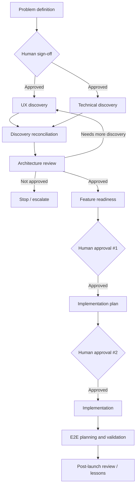

# I Didn't Want AI to Just Write Code. I Wanted It to Participate in the Product Process

*Built while developing a two-sided ride-dispatch app for iOS and Android, ahead of public launch.*

## The problem

Using an AI coding agent can make implementation much faster, but implementation is only one part of building a product.

The harder problem was everything around the code: making sure an agent understood the product intent before changing anything, separating UX questions from architecture questions, catching conflicts between the two, deciding when a feature was actually ready to build, preserving backend contracts, planning tests, and carrying lessons forward without letting an AI silently make product decisions on my behalf.

I did not want a workflow where I wrote a prompt, accepted a large diff, and hoped the reasoning behind it was sound. I wanted a system where different kinds of work had different responsibilities, evidence requirements, escalation paths, and explicit points where a person had to make the decision.

## What I built

I built a governed AI-native product-development operating system around the app.

Instead of treating one AI assistant as a general-purpose teammate, the system separates work into specialized agents and workflows spanning:

- problem definition and discovery
- UX discovery
- technical discovery
- discovery reconciliation
- architecture review
- feature-readiness assessment
- implementation planning
- design analysis and reconciliation
- end-to-end test planning
- platform-evolution review
- architecture and governance drift detection
- post-launch review and lessons learned

The important part is not the number of agents. It is that they do not all have the same authority.

A discovery agent can surface evidence and recommend a direction. It cannot authorize implementation. An architecture review can reject a plan or send it back for more discovery. An implementation-planning agent is not allowed to produce a build plan until the first human approval is on record. Code does not begin until a second human approval of the implementation plan.

That turns the AI from "something that writes code" into a governed participant in a product-development process.

## The workflow

A simplified feature path looks like this:

Several workflows run independent analysis in parallel before synthesis. Discovery runs UX and technical investigation separately. Drift monitoring checks seven dimensions independently before producing one report: architecture, governance, schema, anti-patterns, operational safety, scalability, and hidden coupling.

Feature readiness is checked across 11 dimensions, including business, UX, technical, architectural, operational, scalability, governance, recovery, testing, rollout, and dependencies.

## Why separate agents?

The goal was to reduce a failure mode I kept seeing in AI-assisted work: one model makes an assumption early, then every later step inherits the assumption because the same context and reasoning are carried forward.

Separating responsibilities creates deliberate disagreement.

UX discovery can conclude that a flow should behave one way while technical discovery finds a backend or state-management constraint that makes that unsafe. A reconciliation step has to resolve the conflict before architecture review. If it cannot, the system stops and asks me rather than inventing a compromise.

The same idea applies to design work. A design-analysis agent classifies a proposed change as visual-only, visual-plus-wiring, logic, architecture, or forbidden. A forbidden change is a stop condition, not a suggestion.

## Human authority is part of the architecture

The system has explicit authority boundaries because "human in the loop" is too vague to be useful.

Examples:

- unresolved discovery conflicts stop the workflow
- material PRD changes route back to a human
- architecture can return **Not Approved** or **Requires Additional Discovery**
- implementation planning requires recorded human authorization
- backend scope that was not anticipated during discovery is escalated instead of silently added
- test-environment decisions include a mandatory human pause
- platform-adoption decisions remain human-governed
- lessons and reusable patterns can be proposed by agents, but they are not silently promoted into product doctrine

The point is not to slow the agents down. It is to make clear which decisions are reversible automation and which decisions actually change the product.

## How this differs from my adversarial code-review case study

My [adversarial code-review case study](../2026-09-codex-adversarial-code-review-process/) covers one specific control: an independent reviewer checking actual implementation against product intent and blocking unresolved findings.

This case study is about the larger system around that control.

Code review asks, "Did we build this correctly?"

This operating model also asks:

- Did we define the problem clearly enough to build anything?
- Did UX and technical discovery agree?
- Is the architecture acceptable?
- Is the feature ready?
- What requires a human decision?
- What should be tested end to end?
- What did we learn that should affect the next cycle?

## What this proves, and what it doesn't

This is a real operating system used to structure development of the app, not a hypothetical diagram. The repository contains the agent contracts, workflow definitions, schemas, governance rules, templates, escalation paths, and product-development artifacts that support it.

The app is still ahead of public launch. So I do **not** claim that this workflow has improved customer retention, revenue, development velocity, or production quality by a measured percentage. Those would require live operating data I do not have yet.

What I can show is the system itself: how I turned AI-assisted development into a repeatable product process with specialized responsibilities, independent analysis, explicit escalation, and human decision rights.

## Why I built it this way

The interesting question for me is not whether an AI agent can generate a screen or a Cloud Function. It can.

The harder product question is how to use increasingly capable agents without giving up product judgment, traceability, or the ability to tell why a decision was made.

My answer was to treat the AI workflow itself like a product system: define roles, inputs, outputs, failure states, escalation paths, sources of truth, and feedback loops, then keep the decisions that materially change the product with the human.
