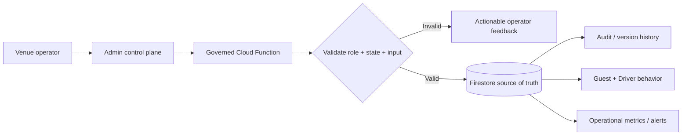

# Turning Venue Operations Into Product Controls Instead of Engineering Tickets

*Built as part of a two-sided ride-dispatch platform for venue transportation, ahead of public launch.*

## The problem

A ride-dispatch product can work perfectly in a demo and still fail operationally.

Real venue operations change during the day. A destination gets congested. A driver needs to be taken offline. Booking should stop before the venue closes. A guest needs an SMS resent. An operator needs to understand why a ride is stuck. A configuration change needs to be made without opening the database console and hoping the right field gets edited.

If every one of those situations requires an engineer, the software has not really absorbed the operational workflow. It has only moved part of it onto a screen.

I wanted the venue team to be able to operate the system safely without needing direct database access or an engineer standing beside them.

## The product decision

I built an operations control plane around the ride platform rather than a collection of one-off admin buttons.

The design principle was simple:

> Give operators control over the decisions that are legitimately operational, while keeping lifecycle integrity, authorization, validation, and auditability server-authoritative.

That boundary matters. "Make it configurable" can easily become "let the client mutate production state directly." I wanted operational flexibility without turning the admin UI into a bypass around the product's safety rules.

## What the control plane covers

The resulting admin experience connects operator workflows to governed backend actions across several areas.

### Ride support

Operators can search for rides using information they actually have during support, including ticket and phone lookup. From the booking detail experience they can take bounded actions such as cancelling a booking or resending an SMS.

The UI translates backend failure states into operator guidance rather than exposing raw technical errors. Rate-limited SMS does not offer a pointless retry button. Delivery failure can offer recovery guidance. A ride that is already terminal is treated as information rather than as an unexplained failed action.

### Driver operations

Operators can force a driver offline, but the backend checks active work and reconciles affected rides rather than simply flipping a boolean.

The operator is shown the consequence of the action, including whether rides will be re-queued, so the interface communicates operational impact before and after the mutation.

### Venue scheduling

Operating hours and booking cutoffs are runtime configuration rather than hardcoded app behavior.

The admin UI supports per-day schedules, open/closed states, last-call and last-booking windows, validation across related fields, and a live preview of when ride requests will stop. If different days close at different times, the preview reflects the different cutoff times rather than showing one misleading example.

The guest experience reads the same venue configuration, so operations and customer-facing behavior stay aligned.

### Congestion controls

Destinations can be placed into **Normal**, **Limited**, or **Paused** modes.

That gives operations a way to throttle or temporarily stop assignments to a congested destination without taking the entire ride service down. Limited mode can constrain active assignments; Paused mode stops new assignments to that destination; Resume restores normal operation.

This turns a real operational condition into a reusable product primitive rather than a manual workaround.

### Configuration governance

Changes to live operational behavior go through a publish workflow that shows field-level differences before the mutation is committed.

The admin can see the previous value, the proposed value, and the operational impact before publishing. Version metadata and a human-readable audit log make changes traceable afterward.

The system deliberately does **not** pretend an unfinished rollback capability exists. Version history can expose where rollback belongs without offering an unsafe partial implementation.

## The architecture behind the controls

The admin surface is not the authority for sensitive operations.

Actions route through Cloud Functions with role checks, validation, transaction safety where needed, locked-field enforcement, and audit logging. Firestore remains the source of truth.

A few examples from the backend work:

- booking cancellation includes driver cleanup and idempotent handling
- forcing a driver offline protects active ride state and handles re-queue behavior
- SMS resend includes rate limiting and fallback behavior
- staff lifecycle and admin roles are controlled server-side
- venue configuration updates validate allowed fields and record versions
- operational notifications can be persisted and pushed to the relevant surface
- audit records are written for administrative actions

That separation lets the interface be useful to a non-technical operator without making the client trusted.

## The guest experience is part of the operations product

One decision I made was not to treat "service unavailable" as a dead end.

When booking is closed or the venue is outside operating hours, guests can still explore ride options while the final booking action remains governed by current venue state. Dynamic messaging can explain availability rather than dropping the user into a generic disabled screen.

This is important because an operational rule has two users: the operator changing the rule and the guest experiencing its consequence.

The product has to make sense on both sides.

## A simplified flow

## What this proves, and what it doesn't

The control plane, backend actions, auditability, scheduling controls, congestion modes, live previews, and guest-state integration are implemented in the private product repositories.

The product is still ahead of public launch. I therefore do **not** claim that these controls have reduced support time, increased throughput, or improved venue KPIs in production. The 5–8 minute booking-to-arrival figure used in the product work is an operational target, not a measured result, and I do not present it as one.

What the work does demonstrate is the product pattern: take messy operational situations, decide which ones should become product capabilities, give the field team safe control, preserve backend authority, and make the same capability reusable across future venues.

## Why this matters to me as a product builder

The part of product work I enjoy most is the boundary between "the customer has a problem" and "the platform now knows how to handle that class of problem."

A one-off operational fix solves today's incident.

A reusable control, with clear permissions, validation, recovery behavior, customer-facing consequences, and an audit trail, turns what was learned in the field into product infrastructure.

That is the difference I was aiming for here.
